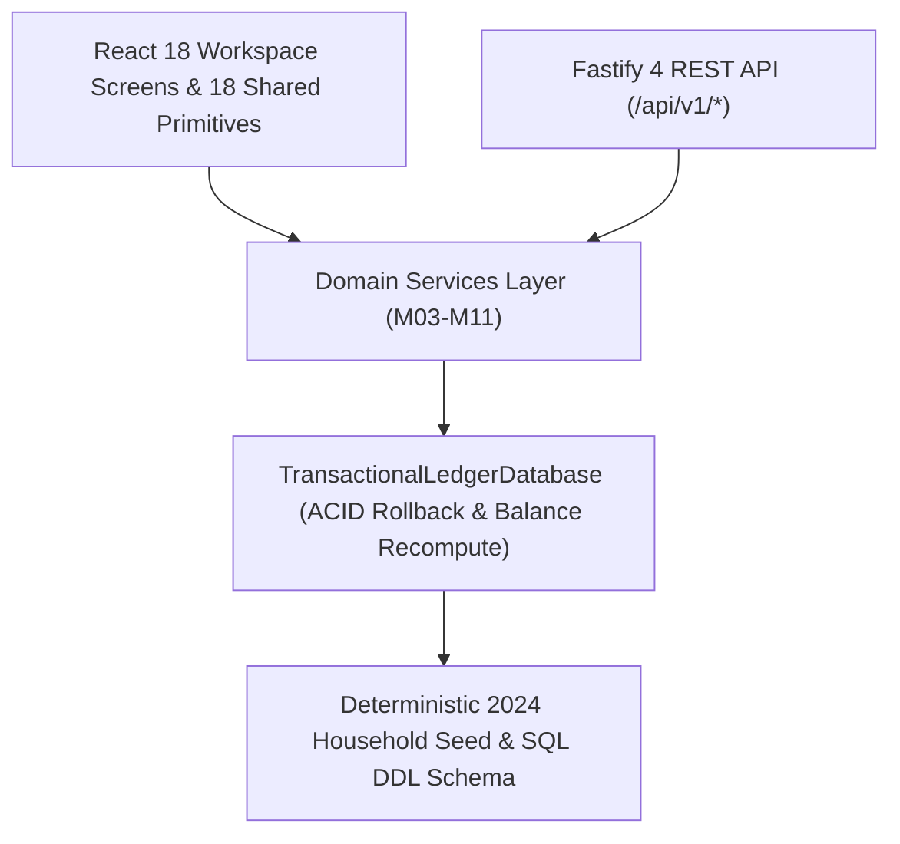

# Architecture, Design System & Screen Inventory

## 1. System Architecture Overview

The **Expense Tracker** is architected as a modular, offline-first financial application where all monetary calculations are performed in integer cents (`number` integers representing minor currency units).

### Core Architectural Invariants
1. **Integer-Cent Monetary Precision**: Every balance, transaction amount, split allocation, budget limit, recurring rule, and receipt item is stored as an integer in cents (`amountCents`). Floating-point numbers are never used for financial storage or arithmetic.
2. **Double-Entry Balance Integrity**: `TransactionalLedgerDatabase.recomputeAllAccountBalances()` deterministically derives every account's `currentBalanceCents` from `openingBalanceCents` plus all chronological `INCOME`, `EXPENSE`, and `TRANSFER` legs.
3. **Split Sum Invariant**: When `isSplit === true`, `verifySplitSumMatchesTotal()` enforces that the sum of `splits[].amountCents` equals `transaction.amountCents` to the exact cent.
4. **100% Offline Execution**: All fonts (`public/assets/fonts/*.woff2`), icons (`public/assets/icons/sprite.svg`), charts (`CashflowSvgCharts.tsx`), and persistence operate locally with zero external network requests.

---

## 2. Design Token System & WCAG AA Accessibility

All visual styling is governed by `src/styles/tokens.ts` and exposed as CSS custom properties in `src/styles/globals.css` via `ThemeProvider.tsx`. Raw hex values are strictly prohibited outside `src/styles/tokens.ts`.

### Semantic Token Mapping
- **Surfaces**: `--bg-primary`, `--bg-secondary`, `--bg-tertiary`
- **Typography**: `--text-primary`, `--text-secondary`, `--text-muted`
- **Borders & Focus**: `--border-default`, `--border-strong`, `--focus-ring`
- **Brand & Status**: `--accent-primary`, `--accent-hover`, `--accent-text`, `--success`, `--success-bg`, `--warning`, `--warning-bg`, `--danger`, `--danger-bg`
- **Typography Scale**:
  - Primary UI Sans: `InterLocal` (400, 500, 600, 700)
  - Tabular Numeric Mono: `JetBrainsMonoLocal` (`font-variant-numeric: tabular-nums`) for all currency columns, account masks, and percentages.

---

## 3. Complete Screen Inventory (`S01`–`S08`)

| Screen ID | Route / Nav | Component | Primary Responsibilities |
| :--- | :--- | :--- | :--- |
| `S01` | Header / RBAC | `AppShell.tsx` / `SettingsScreen.tsx` | Workspace user identity, active accounting period selector, theme toggle, and RBAC role matrix (`OWNER`, `MEMBER`, `VIEWER`). |
| `S02` | `/` | `OverviewScreen.tsx` | Executive KPIs (Net Worth, Monthly Income, Monthly Spend, Savings Rate), 5-Month SVG Cashflow Bar Chart, Category Spend Share Chart, Recent Ledger Activity, and Upcoming Bills. |
| `S03` | `/transactions` | `TransactionsScreen.tsx` | Filterable & paginated ledger table, Record Transaction modal, 2-way Split Allocation drawer, and bulk category update bar. |
| `S04` | `/accounts` | `AccountsScreen.tsx` | Institution account cards, net worth & credit utilization summary, Inter-Account Transfer modal, and Statement Reconciliation drawer. |
| `S05` | `/budgets` | `BudgetsScreen.tsx` | Monthly category budget progress bars, rollover carry-over badges, `OK`/`WARNING_80`/`EXCEEDED_100` filters, and previous-month copy action. |
| `S06` | `/recurring` | `RecurringScreen.tsx` | Active recurring bills & subscriptions table, 42-cell monthly obligation calendar view, and immediate occurrence posting. |
| `S07` | `/receipts` | `ReceiptsScreen.tsx` | Itemized receipt line items (`quantity * unitPrice + tax`), reimbursement claim status transitions, and 50/50 shared expense split tracking. |
| `S08` | `/settings` | `SettingsScreen.tsx` | Category & Priority Merchant Auto-Rule manager, CSV/JSON import-export portability tools, Household RBAC member directory, and immutable Security Audit Log. |

---

## 4. REST API Endpoints (`src/server/app.ts`)

| Method | Path | Description |
| :--- | :--- | :--- |
| `GET` | `/api/v1/health` | Returns offline status, schema version, and entity counts. |
| `GET` | `/api/v1/openapi.json` | Returns OpenAPI `3.0.3` specification document. |
| `POST` | `/api/v1/auth/login` | Authenticates user credentials and issues session + CSRF token. |
| `GET` | `/api/v1/accounts` | Lists active accounts and computed household net worth summary. |
| `POST` | `/api/v1/accounts` | Creates a new financial account and records an audit log entry. |
| `GET` | `/api/v1/categories` | Lists categories, tags, and priority-ordered merchant rules. |
| `GET` | `/api/v1/transactions` | Queries paginated ledger transactions with search and filter parameters. |
| `POST` | `/api/v1/transactions` | Records a new expense, income, or split transaction. |
| `GET` | `/api/v1/budgets` | Computes monthly budget envelopes and utilization alerts for `YYYY-MM`. |
| `POST` | `/api/v1/budgets` | Upserts a monthly category budget envelope. |
| `GET` | `/api/v1/recurring` | Returns recurring obligations and 42-cell monthly calendar grid. |
| `GET` | `/api/v1/receipts` | Returns itemized receipt lines and reimbursement claim totals. |
| `GET` | `/api/v1/analytics/overview` | Computes multi-month cashflow series, category shares, and top merchants. |
| `GET` | `/api/v1/system/search` | Executes global `Ctrl+K` command search across all ledger entities. |
| `GET` | `/api/v1/system/export.csv` | Exports deterministic CSV ledger snapshot. |
| `GET` | `/api/v1/system/export.json` | Exports complete JSON database state bundle. |
